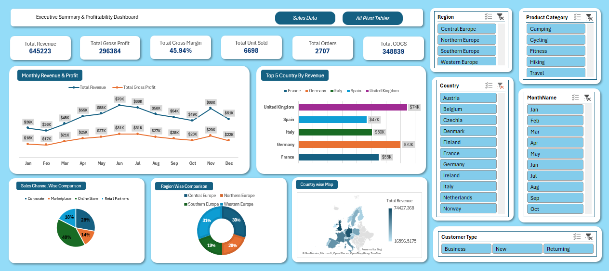

1. Project Title: Executive Summary & Profiitability Dashboard
2. Short Description : Developed an interactive Executive Sales & Profitability Dashboard in Microsoft Excel to analyse business performance, revenue trends, and profitability. Includes KPI tracking for Total Revenue, Total Gross Profit, Gross Margin, Units Sold, Orders, and COGS. Features monthly revenue and profit trends, country-wise revenue bar chart, channel-wise revenue pie chart, region-wise comparison, geographical sales map, and dynamic filters for region, product, country, month, and customer.

3. Tech Stack:
- Microsoft Excel: Dashboard development and data analysis.
- Pivot Tables: Data summarization and performance analysis.
- Pivot Charts: Visual representation of sales and profitability trends.
- Slicers: Interactive filtering by region, product, country, month, and customer.
- Data Visualization: KPI tracking, charts, and geographical sales mapping.

4. Data Source Dataset: 
5. Features & Highlights:
  A. Business Problem:
  B. Project Goals:
  C. Dashboard Overview & Key Visuals:
  D. Business Impact & Insights The dashboard enables management to:
  E. Key Business Insights The dashboard helps answer important business questions:

6. Screenshot Show what the dashbard looks like :-

